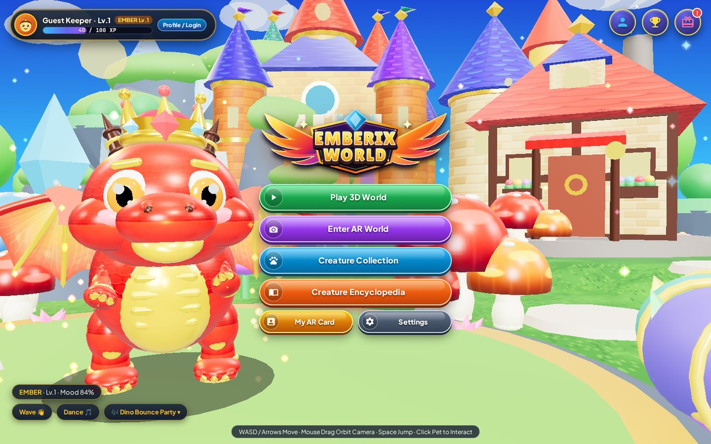
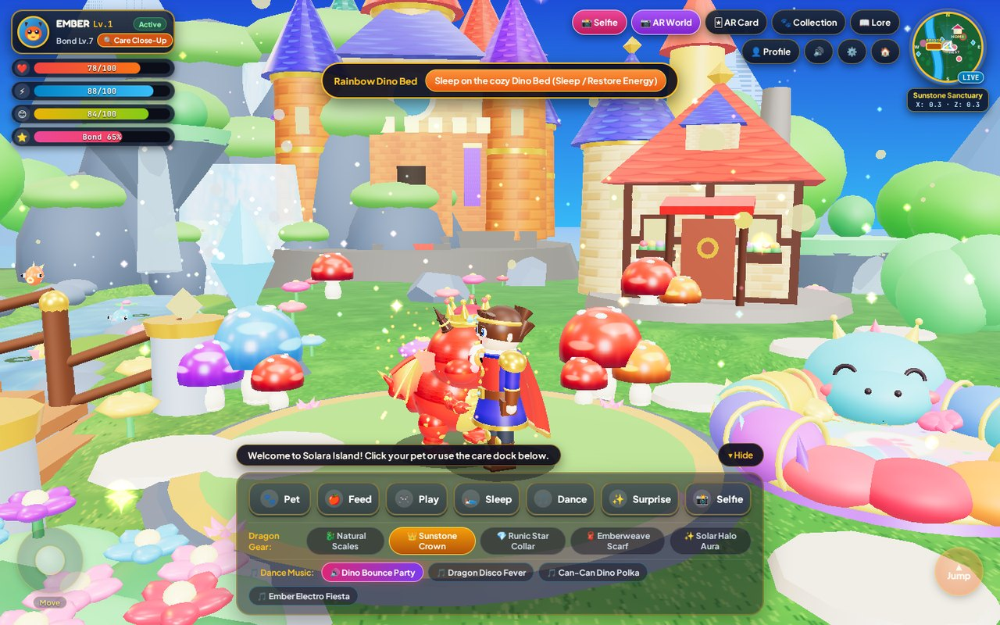
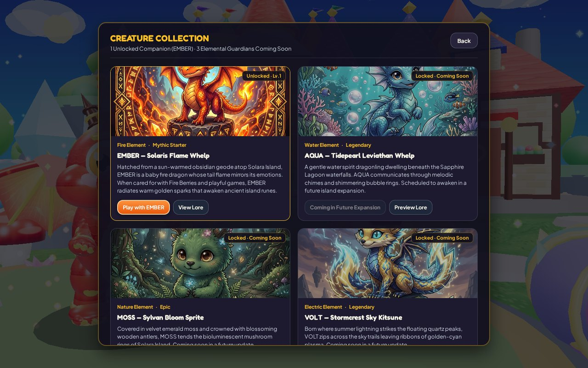
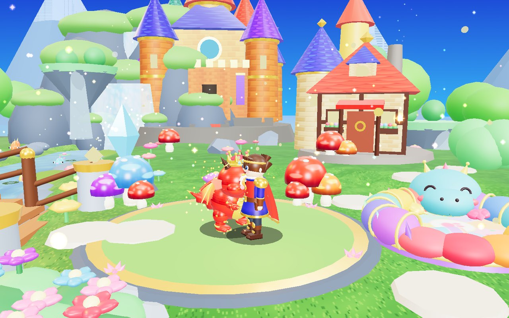
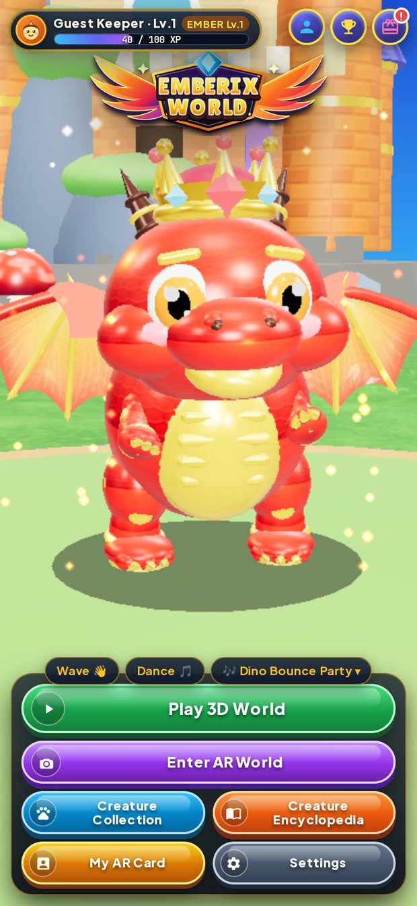

# Emberix World

**A 3D virtual pet you raise, walk around with, and summon onto a real AR card.**

🔗 **Live demo:** https://emberix-world.vercel.app/
🎥 **Demo video:** _coming soon_
🏆 Built for **IceHacks** (November 2026)



---

## Screenshots

Walk around the island with your pet, take care of it in the world it actually
lives in — then summon it onto a card on your desk.

| In the world | Creature Collection |
|---|---|
|  |  |



<sub>AR mode: EMBER anchored to the printed marker card, standing on it in
perspective and reacting to taps. The same creature, the same stats, the same
bond you built in 3D.</sub>



<sub>The whole thing runs on a phone — guest mode, no sign-up.</sub>

## What this is

Emberix World is a browser-based pet simulator starring **EMBER**, a baby fire
dragon. You don't watch EMBER through a menu — you drop into a 3D island, walk
up to your pet, and take care of it in the world it lives in.

The pet has needs that decay on real wall-clock time, even while the tab is
closed. Feed it, play with it, pet it, teach it to dance, or put it to sleep.
Those choices feed a friendship level and an XP track that persist between
visits.

The trick that ties it together: **EMBER physically exists outside the screen
too.** Print the companion card, point your phone camera at it, and EMBER is
summoned onto the card — anchored to the paper, standing on it in perspective,
reacting to your taps. Same creature, same stats, same bond.

## Features

**Pet simulation**
- Live needs loop — hunger, happiness, energy — with offline time decay
- Friendship levels and XP progression
- Care actions: Feed, Play, Pet, Dance, Sleep
- Daily reward with a claim streak

**3D world**
- Walkable fantasy island with a controllable keeper avatar
- Real-time minimap / radar navigation
- Chase camera, collision-aware movement, pathfinding
- Ambient soundtrack and interaction SFX

**AR**
- Camera-based card detection driven by a printed physical card
- EMBER anchors to the detected card, scales with its size in frame, and can be
  interacted with in AR
- Detection is a luminance-and-chroma match against the compiled card target
  that runs in the browser — no feature tracking, no pose estimation
- In-app **AR card generator** so anyone can produce the card themselves
- Marker-anchor preview mode, usable without a printer

**Around the pet**
- Creature Collection and Creature Encyclopedia
- Keeper Passport profile (level, XP, achievements, companion summary)
- Photo mode / selfie capture
- Pet renaming

**Accessibility and reach**
- **Guest mode** — every 3D and AR feature works with no sign-up
- Optional local accounts for saving progress under a name
- Interface available in **English, Bahasa Indonesia, and 中文**
- Responsive: verified on desktop and iPhone-class viewports

## The four creatures

| Creature | Element | Status |
|---|---|---|
| **EMBER** — Solaris Flame Whelp | Fire · Mythic Starter | Playable starter |
| **AQUA** — Tidepearl Leviathan Whelp | Water · Legendary | Locked, future expansion |
| **MOSS** | Nature · Epic | Locked, future expansion |
| **VOLT** | Electric · Legendary | Locked, future expansion |

EMBER is the one you raise today. AQUA, MOSS and VOLT are wired into the
Collection and Encyclopedia as the shape of what comes next.

## Try the AR mode

1. Open the app on a phone: https://emberix-world.vercel.app/
2. Tap **AR World** → **Get AR Card**
3. Print the card (or open it on a second screen)
4. Point the camera at the card — EMBER appears standing on it

No printer? Use **Preview Marker Anchor** inside AR mode to place the pet
without a card.

## Tech

- **Three.js** for the 3D world, creature and rendering
- **XR Blocks** for the spatial UI layer
- **Custom card detector** for AR (luminance + chroma match against a
  1024×1024 target compiled to `.mind`)
- **Rapier** for physics, **three-pathfinding** for navigation
- **Vite + TypeScript**, no framework runtime for the shell
- All state in **`localStorage`** — no backend, no analytics, no tracking

## Run locally

```bash
npm install
npm run dev      # http://localhost:3000
```

```bash
npm run build    # production bundle into dist/
npm run preview  # serve the production build
npm run lint     # TypeScript type check
```

Camera access for AR requires a secure context — use `localhost` or HTTPS.

## Project structure

```
src/
  ar/cardDetector.ts         Card matching: luminance grid + chroma
  ar/MindARTracker.ts        AR scene wiring, camera and anchor
  creatures/EmberModel.ts    EMBER geometry, rig and animation
  game/rules.ts              Care loop: stats, decay, XP, friendship, rewards
  game/rules.test.ts         Unit tests for the care loop rules
  storage/StorageManager.ts  Local persistence, accounts, save migration
  ui/GameUI.ts               HUD, panels, Collection, Encyclopedia, Passport
  world/                     Island, player controller, world engine
  i18n/translations.ts       English / Bahasa Indonesia / 中文
public/assets/
  images/                    Creature artwork
  ar/                        AR card art, printable PDF, compiled .mind target
docs/screenshots/            Screenshots used in this README
docs/video-thumbnail.jpg     Demo video thumbnail (1280x720)
public/
  og-emberix-world.jpg       Social preview card (1200x630)
  manifest.webmanifest       Web app manifest
  icons/                     App icons
```

## Privacy

There is no server. Progress, accounts and settings live only in your browser's
`localStorage`. The camera is used solely for card detection and photo capture;
no frames are uploaded anywhere. Clearing site data resets the pet.

## Known limitations

Listed honestly, because they are the next things to build rather than
oversights:

- Only EMBER is playable; AQUA, MOSS and VOLT are teasers
- Progress is per-browser; Keeper Code moves it to another device manually
- Local accounts are a convenience, not real authentication
- The printable AR card ships as a 1024×1024 PNG and a single-page PDF
- A web app manifest and icons are shipped, but there is no service worker yet,
  so the app is not cached for offline play

## AI usage disclosure

In line with the IceHacks rules: generative AI tools were used during this
build for **concept art and image asset generation**, and for **coding
assistance**. Game logic, 3D scene composition, AR integration and the care
loop were assembled, wired and tested by the author. All AI-generated imagery
is original output produced for this project.

## License

Source code is released under the **MIT License** — see [LICENSE](LICENSE).
Artwork, the 3D creature model, the AR card and audio assets are original work
for this project and are covered by the same license unless stated otherwise.

Third-party libraries remain under their own licenses (Three.js, XR Blocks,
Rapier and others — see `package.json`).
